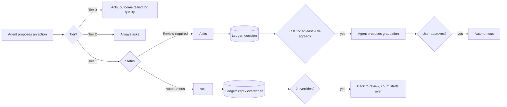

# earned-autonomy


An agent that asks about everything is useless, and one that asks about nothing is dangerous. This package makes
autonomy something an agent earns one action type at a time, from logged human decisions. Every action type
starts out needing review. A type graduates to running on its own only after the person it works for has agreed
with it often enough, and only when that person approves the graduation. Two overridden calls send it back to
review. Actions that are external, financial or irreversible never graduate. The execution side comes with it:
permission lanes for dispatched agent jobs, one-shot and timed permission grants, a git push block, and a guard
that refuses to touch protected categories even after an action was approved.

**Status:** finished work sample, maintained on my own cadence. Extracted from a private multi-agent system; the
git history starts at extraction.

## Why this exists

I run a personal assistant agent that triages my email and calendar. On day one, every proposal it made needed a
yes or no from me, which is safe and also exhausting. Granting it broad permission up front was the opposite
mistake. So I set a rule before it went live: trust is earned per action type, from a rolling window of my real
decisions, and the agent can propose a graduation but never grant one to itself.

<!-- evidence:start -->
Here is where that stands, read from the private system's tier map and decision log as of 2026-11-06:

- **57 answers logged** between 2026-09-17 and 2026-10-31, across 4 action types. 56 are decisions; the 57th is
  a graduation answer that the bug described below miscounted as a decision.
- **"Trash no-value email" graduated** at 15/15, 100% agreement. I approved the graduation on 2026-10-26; it
  only took effect on 2026-11-01, which is the second story under "What the audit trail caught".
- **"Archive newsletter/promotional email" is still gated:** 12/15 logged, 17% agreement. 8 of the 12 were
  "modified": the agent was mostly right about what to archive and wrong about one or two items each time. More
  volume will not graduate it. Only agreement will.
- **"Snooze a non-urgent thread"** is at 4/15 (100%), and "Decline a clearly conflicting invite" at 0/15.
- **Tier 2 never graduates.** Five categories are permanently gated; 3 Tier 2 decisions were logged and none of
  them counts toward anything.
- **Demotions to date: 0.** The demotion path is exercised by the tests and the demo, not yet by real data.
<!-- evidence:end -->

The numbers are small, and the box under "Limits" says exactly how small.

## How it works



**The policy.** Each action type sits in one tier. The rules are config, with these defaults:

| Tier | Starts as | Can graduate? | Rule |
|---|---|---|---|
| 0 | Autonomous | Not needed | Read-only work, internal logging, drafts. Outcomes are tallied for quality only. |
| 1 | Review-required | Yes, per type | At least 90% agreement over the most recent 15 decisions makes it a candidate. The agent proposes; the user approves. 2 overridden calls on a graduated type demote it. A declined graduation or a demotion starts the count over. |
| 2 | Review-required | Never | Sending anything to another person, cancelling or moving a meeting with others, any financial action, submitting an application or a form, anything irreversible or reputation-facing. |

**The ledger is the only state.** Decisions go into an append-only JSONL file. Each record has an id, which makes
appends idempotent. Status is never stored. `policy.evaluate` replays the log every time, so a status cannot drift
from the decisions behind it. A graduation answer is its own record kind and is never tallied. "Approved" counts as
agreement; "modified" and "rejected" do not.

**Unattended channels can only transcribe.** When a question goes out through a queue or a chat message, `ask`
records it. A transcriber writes the answer with `log --via-queue`, and that call refuses any id that was never
asked, or that was already answered. Something reading a message queue cannot originate a decision.

**The execution side** (`earned_autonomy.guard`):

| Guardrail | What it does |
|---|---|
| Permission lanes | A lane is the set of tools a dispatched job may use. The allowlist is the boundary: the job sees only the lane's tools and ignores ambient settings. The deny list is a second layer. `audit()` reports every write-capable tool a lane can actually reach. |
| Read-only lane | Read and search tools only. No shells, no file writes, and no subagents, because a subagent's isolation parameter cannot be matched by a permission rule. |
| Scoped write lane | Read-only, plus `Write`/`Edit` limited to the folders a workflow declares as its outputs. A workflow that declares its own tool list is refused this lane. |
| One-shot grants | A job stopped on a denied tool can be re-run with that one tool. A restricted lane is refused outright. The re-run is the job's own request, the grant is used once, and any failure after the claim expires the job. |
| Timed grants | The expiry is stored on disk, not in a timer. Startup revokes what expired while the process was down and re-arms the rest. A grant never revokes a rule it did not add. |
| Push block | Every git transport and gh credential is blocked in the job's environment, so `git -C x push`, `send-pack`, `gh` and a nested agent all fail while local git still works. |
| Protected categories | An approved "trash" on a protected sender runs as "archive", with the reason. Categories are config (exact address, domain, domain suffix). A target the guard cannot parse is protected. |

Runtime specifics live in one labeled adapter, `adapters/claude_code.py`: the `claude -p` command, its
permission flags, and parsing the structured `permission_denials` field. The core names no runtime, mail
provider, chat tool or file layout. To plug in another runtime, implement `PermissionBackend` and your own
command builder.

## What the audit trail caught

**The read-only lane that could write.** A read-only job had `Write` refused and then wrote a file anyway, using
the PowerShell tool. *Cause:* the lane's deny list named `Bash` but not `PowerShell`, the ambient project
settings allowed `PowerShell`, and the default permission mode let through anything the settings allowed and the
lane did not deny. A deny list was the
only barrier, and it had a gap. *Fix:* the allowlist became the boundary. The job launches with only the lane's
tools (`--permission-mode dontAsk --restricted --tools ...` in the adapter), ignores ambient settings, and
refuses anything unlisted; subagents left the lane. *Guard:* `tests/guard/test_lanes.py` audits the old shape and
finds `PowerShell`, then checks that the shipped lane reaches no write-capable tool even when the ambient settings
allow all of them.

**The approved graduation that never applied.** I approved a graduation through a chat message. The transcriber
sent it down the ordinary decision path, which appended my answer as one more approved decision (so the
graduation answer was counted among the 15 decisions it was judging), announced the candidacy again, and never
changed the status. Only an interactive session could do that, and no interactive session was told. The type sat
at review-required for six days after I said yes. *Cause:* status was a field that a separate step had to update,
and the unattended path had no such step. *Fix:* a graduation answer is its own record kind, never tallied, and
status is derived from the ledger on every read, so an answer that is in the log cannot fail to apply. *Guard:*
`tests/policy/test_graduation_answer.py` checks that the answer leaves the window unchanged, that a fresh reader
sees Autonomous with no other write, and that no second proposal follows.

## Limits and non-goals

> **How much 15/15 proves.** The Wilson 95% lower bound on 15 agreements out of 15 is about 0.80. On 14/15,
> which passes the 90% rule, it is about 0.70. So the 90% threshold is a policy choice, not a statistical
> guarantee that the agent is right 90% of the time. `status` prints the bound next to every rate so nobody has
> to take the percentage at face value.
>
> **Why 15.** The window is a volume choice. Volume varies a lot by type: trash came up almost daily and filled its
> window less than three weeks after it was added on 2026-10-06, while snooze has 4 decisions in seven weeks. A
> window several times larger would mean the slower types never graduate. The actions that graduate first are also the cheap ones to undo (email trash is
> recoverable for 30 days), and Tier 2 holds the costly ones whatever the history says.
>
> **What would change it.** A Tier 1 type where a single mistake is expensive needs a bigger window or a higher
> threshold. Clearing a 0.90 lower bound takes 35 straight agreements. A real demotion would test whether 2
> overrides is the right trigger, and none has happened yet. Both numbers are config (`rules` in the policy file).

- **Not a security sandbox.** Lanes and the push block stop accidents and ordinary mistakes by an agent doing its
  job. A job that has a shell and sets out to undo its own environment can do it. The asked lane has a shell on
  purpose.
- **It doesn't replace OS-level permissions.** Run agents as a user that cannot touch what they must never touch.
  This package works one layer above that.
- **Agreement is binary.** "Modified" counts the same as "rejected", even when the agent was nearly right. That is
  why the archive type sits at 17%.
- **It does not judge single instances.** A graduated type can still meet an unusually high-stakes case, and
  deciding to escalate that one case is up to the agent, outside this package.
- **The CLI flags in the adapter** were verified against the CLI version current when the lanes were built.
  Re-verify them against yours.

For a wider view of how much autonomy agents get in practice, see Anthropic's
[Measuring agent autonomy](https://www.anthropic.com/research/measuring-agent-autonomy).

## Install and run

```bash
git clone https://github.com/Josevventures/earned-autonomy
cd earned-autonomy
pip install -e .
python -m earned_autonomy demo
```

The demo copies a synthetic ledger (every name, address and note in it is invented) to a scratch folder and runs
four scenarios in well under a second. No network, no keys, no dependencies.

With your own policy (start from `earned_autonomy/examples/policy.json`):

```bash
python -m earned_autonomy log --id D-1 --type "Archive a promotional message" \
    --proposed "Archive 4 promotional messages" --call modified --note "keep the one with a credit"
python -m earned_autonomy status
python -m earned_autonomy check --type "Any financial action"        # exit 1: refused
python -m earned_autonomy graduate --type "Trash a low-value message" --call approved
python -m earned_autonomy outcome --id O-1 --type "Trash a low-value message" --result overridden
```

## Sample output

From `python -m earned_autonomy demo`:

```
== 1. 'Trash a low-value message' reaches 15/15 ==============================
   GRADUATION PROPOSED (GRAD-trash-a-low-value-message-1): Trash a low-value message agreed 15/15. Waiting for the user's approval; the agent never self-promotes.
   May it act alone yet? no: Trash a low-value message: Graduation pending approval, ask the user
   The user approves the graduation.
   GRADUATED: Trash a low-value message now runs on its own. 2 overridden calls send it back to review.
   May it act alone now? yes: Trash a low-value message: Autonomous

== 2. 'Archive a promotional message' stays gated ============================
   Archive a promotional message: 2/13 agreed (15%), status Review-required. More volume does not buy autonomy; agreement does.

== 3. 'Snooze a non-urgent thread' is overridden twice =======================
   After one override: Autonomous (one edge case is not a trend)
   DEMOTED: Snooze a non-urgent thread had 2 overridden calls and is back to review-required. The count starts over.

== 4. Tier 2 and the protected-category guard ================================
   REFUSED: Send a message on the user's behalf: Tier 2 (external, financial or irreversible), needs the user's sign-off every time
   Approving a graduation for it is refused too: Send a message on the user's behalf is Tier 2: only Tier 1 types can graduate
   trash deals@shop.example.com: runs as trash
   trash alerts@examplebank.test: runs as archive (protected (bank or creditor): trash became archive)
```

`status` on the final state:

```
Action type                                 Tier  Status                   Window    Agreement  Wilson 95% low
------------------------------------------  ----  -----------------------  --------  ---------  --------------
Read-only research note                     0     Tier 0, tracked          3/15      67%        21%
Trash a low-value message                   1     Autonomous               15/15     100%       80%
Archive a promotional message               1     Review-required          13/15     15%        4%
Snooze a non-urgent thread                  1     Review-required          0/15      -          -
Decline a clearly conflicting invite        1     Review-required          0/15      -          -
Send a message on the user's behalf         2     Tier 2, never graduates  2 logged  -          -
Cancel or move a meeting with others        2     Tier 2, never graduates  0 logged  -          -
Any financial action                        2     Tier 2, never graduates  0 logged  -          -
Submit an application or form               2     Tier 2, never graduates  0 logged  -          -
Anything irreversible or reputation-facing  2     Tier 2, never graduates  0 logged  -          -
```

## Origin

I extracted this from the private multi-agent system I run for my own work, where it gates what my assistant
agent may do without asking. The two copies have diverged on purpose: this one is generalized, and the private
one keeps its integrations. The git history starts at extraction.

## Tests

```bash
pip install -e ".[test]"
pytest
```

Three suites, each its own CI job: `tests/policy` (the rules, the ledger, the queue guard, the graduation-answer
regression), `tests/guard` (lanes, the scoped write lane, grants, protected categories, and the push block against
real git) and `tests/cli` (the demo and every command's exit code).

## License

MIT, see [`LICENSE`](LICENSE).
